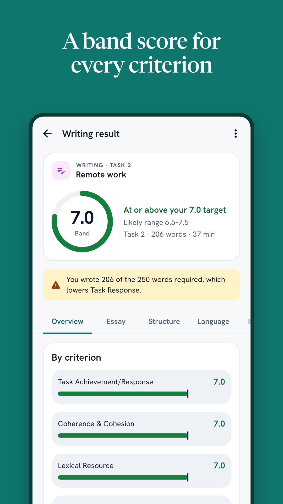
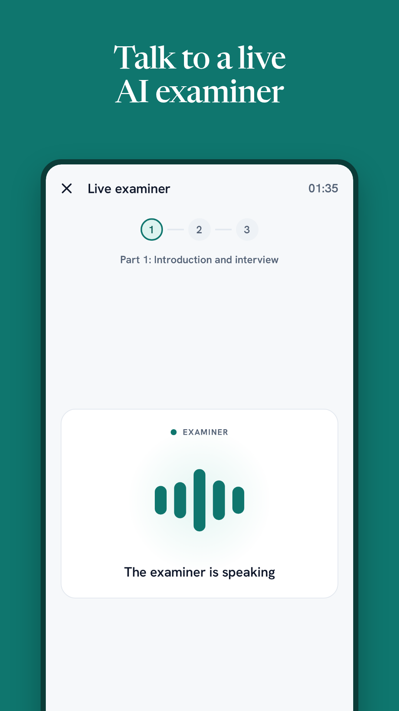
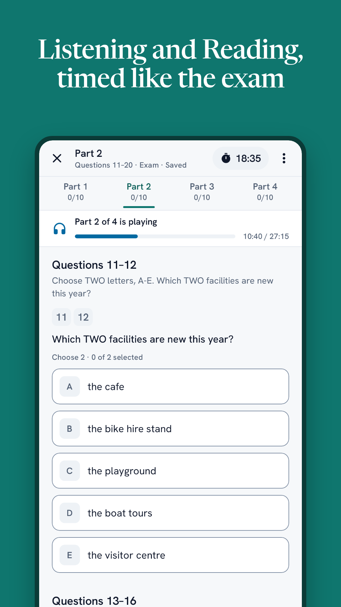
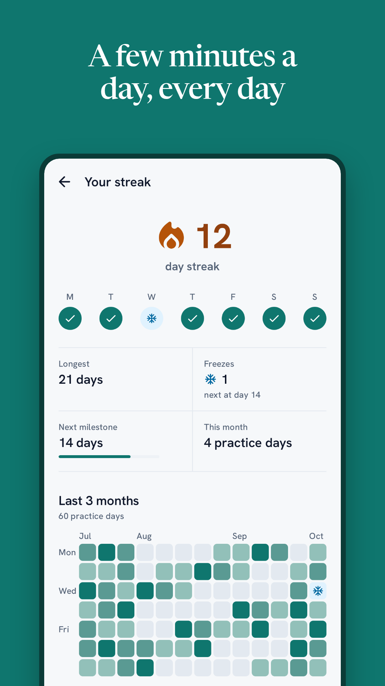

# NextBand

IELTS practice that tells you what band you would get today, and why. Live at **[nextband.app](https://nextband.app)**, with an Android app on Google Play (closed testing).

<p>
  
  
  
  
</p>

## What it does

- **Writing:** Task 1 and 2 on the real clock, a band for each criterion, and every grammar and vocabulary mistake marked in the essay with the fix and the reason.
- **Speaking:** record Parts 1–3, or talk to a live AI examiner that asks follow-up questions. Results show bands, the transcript, pace, pauses and words to work on.
- **Listening and Reading:** full 40-question tests in exam and practice modes; after each test, the transcript or passage with the answer highlighted and why each mark was lost.
- **Full mock test**, **drills built from your own mistakes** (spaced repetition), daily streaks and push reminders.

## Stack

| Part | Tech |
|---|---|
| Web (`apps/web`) | Vite, React, TanStack Router and Query, typed client generated from the OpenAPI spec |
| API (`apps/server`) | Hono + zod-openapi, Drizzle ORM, Postgres, Better Auth, Cloudflare R2, FCM push |
| Android (`apps/android`) | Kotlin, Jetpack Compose, screenshot tests in CI |
| iOS (`apps/ios`) | SwiftUI |
| Shared (`packages/core`) | Band and scoring logic used by the server and web |
| Live examiner (`services/livekit`) | LiveKit agent worker (Python): streaming speech-to-text and an LLM examiner |

Scoring runs through OpenRouter. Deploys are Docker images built in GitHub Actions and run on Dokploy.

## Run it locally

```sh
pnpm install
cp .env.example .env                # point DATABASE_URL at a Postgres, fill in the keys you need
pnpm dev                            # web on :5173, API on :8787
```

Tests: `npx vitest run` inside each package. After changing API schemas, run `pnpm gen:api`. Android builds run in CI (`.github/workflows`).

NextBand is independent and not affiliated with the British Council, IDP: IELTS Australia or Cambridge University Press & Assessment. IELTS is a registered trademark of those organisations.
